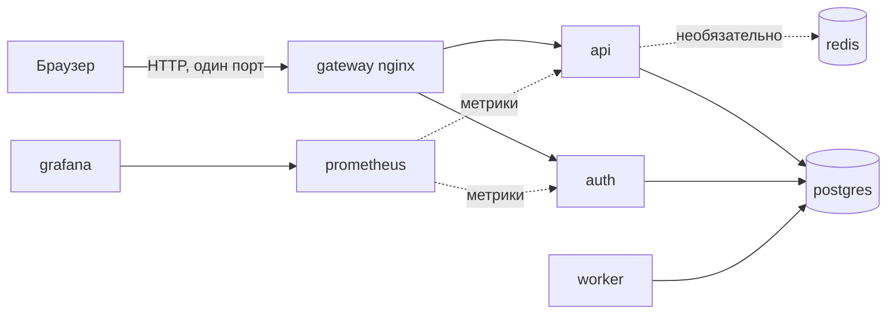
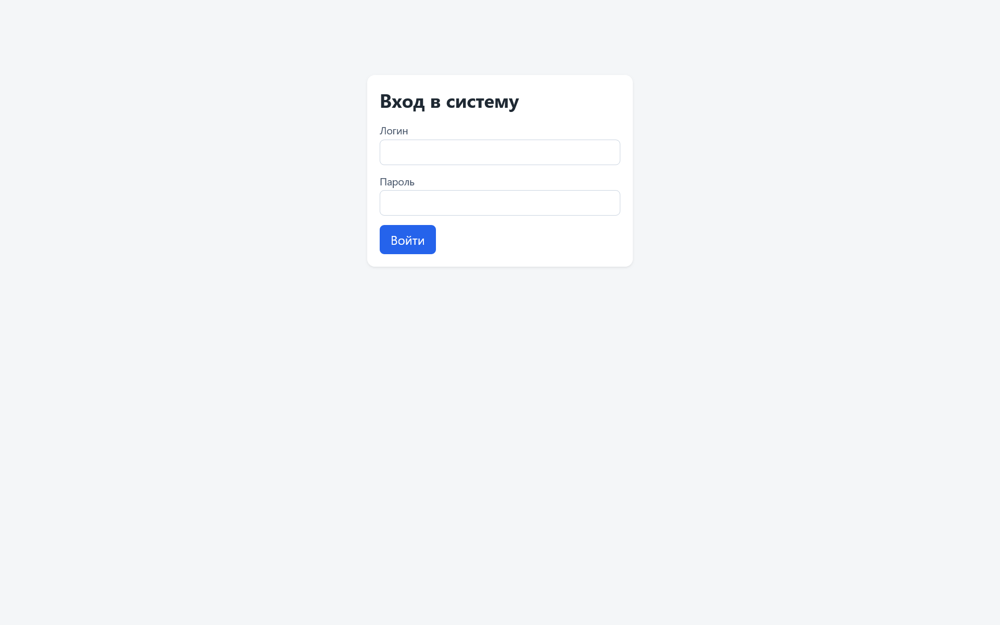
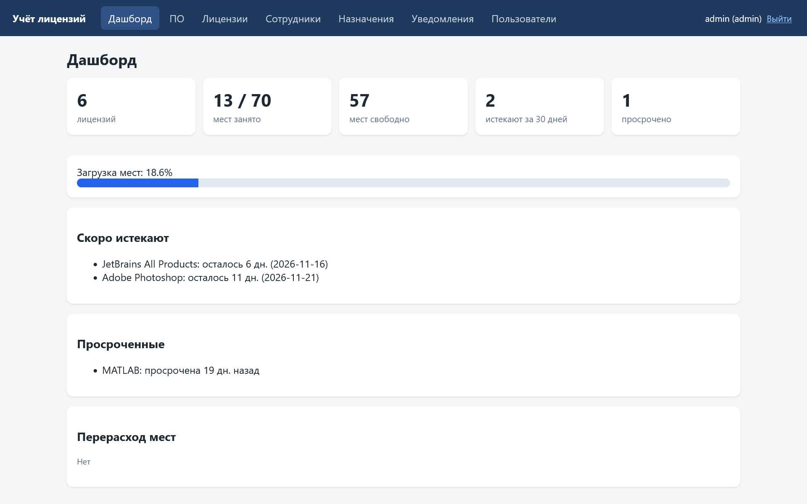
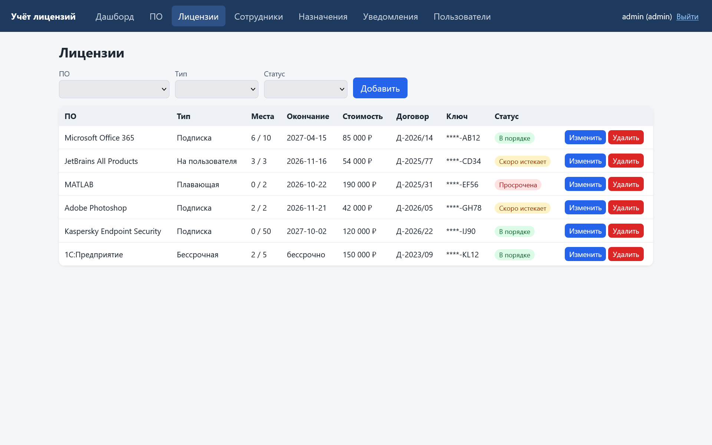
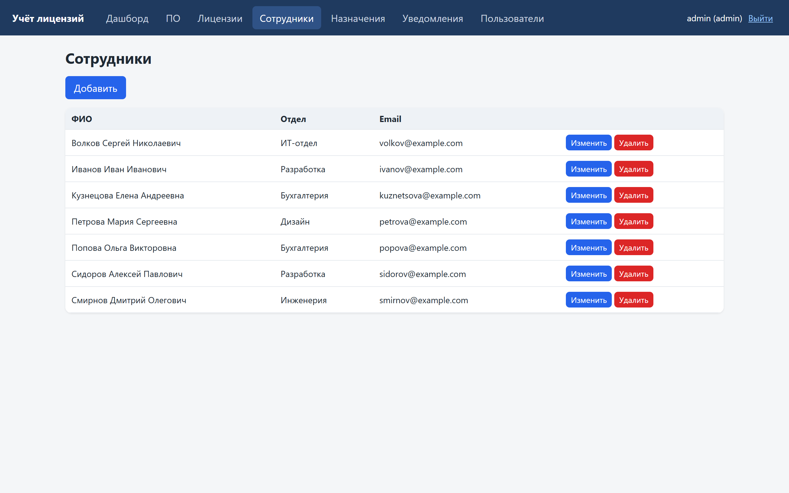
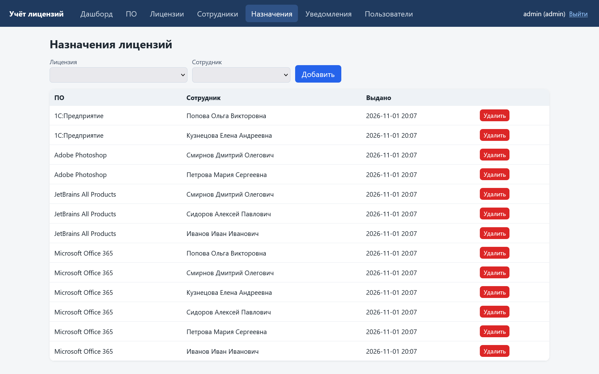
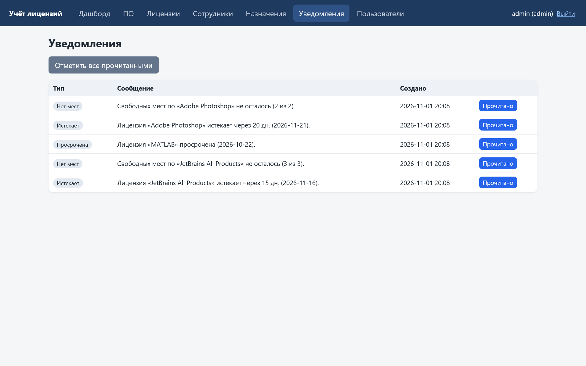
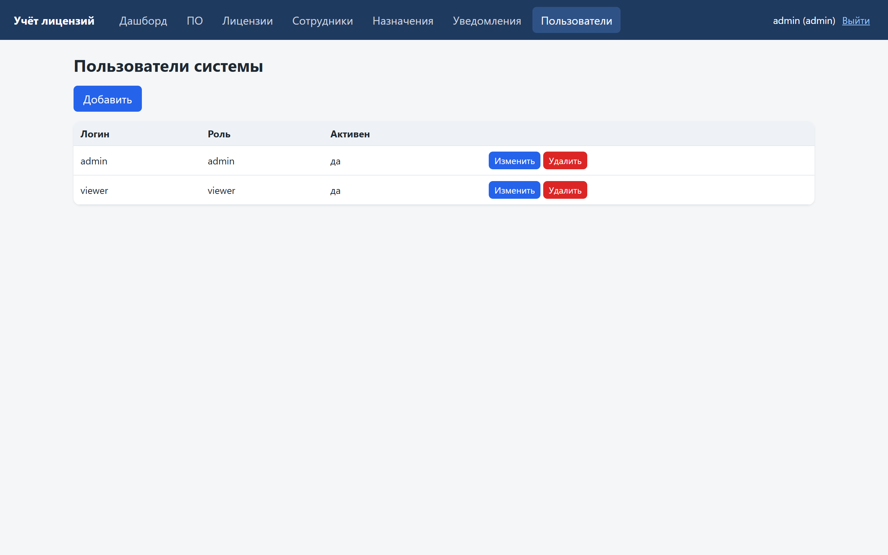
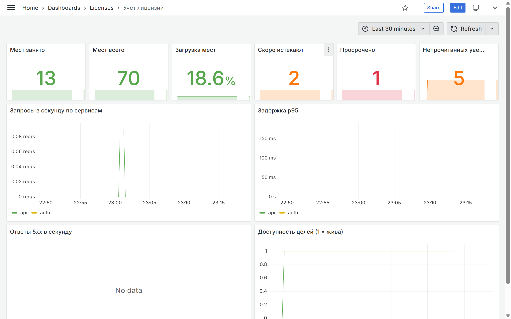
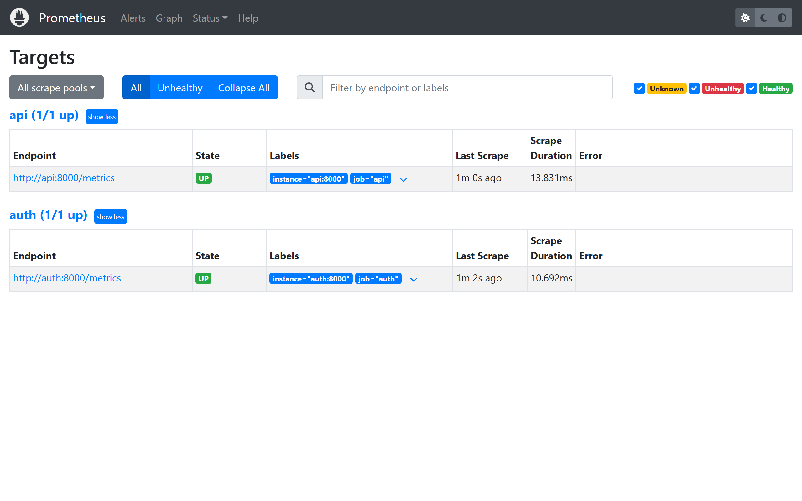

# Система учёта лицензий на ПО

Учебный проект по дисциплине «Настройка и администрирование сервисного программного обеспечения».
Тема: настройка и администрирование системы управления лицензиями на программное обеспечение в корпоративной среде.
Система ведёт учёт лицензий в компании: что куплено, на сколько мест, кому выдано, когда истекает. Лицензионные ключи она не выдаёт.

## Что внутри

| Сервис | Технология | Зачем |
|---|---|---|
| gateway | nginx | единая точка входа, отдаёт статику Vue, проксирует `/api` и `/auth` |
| api | FastAPI | лицензии, ПО, сотрудники, назначения, дашборд, метрики |
| auth | FastAPI | вход, JWT, пользователи (роли admin и viewer) |
| worker | Python | раз в N секунд создаёт уведомления об истекающих лицензиях и нехватке мест |
| postgres | PostgreSQL 16 | хранение данных |
| redis | Redis 7 | необязательный кэш дашборда |
| prometheus | Prometheus | сбор метрик |
| grafana | Grafana | готовый дашборд |

Всего 8 контейнеров.

## Схема



Подробнее: [docs/ARCHITECTURE.md](docs/ARCHITECTURE.md).

## Быстрый старт (Windows, PowerShell)

Нужны Docker Desktop (бэкенд WSL2) и Git.

```powershell
Copy-Item .env.example .env        # затем откройте .env и замените все change_me_...
docker compose up -d --build       # 8 контейнеров
docker compose exec api python -m api.seed   # демо-данные
```

Откройте http://localhost:8080 и войдите как `admin` с паролем из `ADMIN_PASSWORD` в `.env`.
Демо-пользователь для чтения: `viewer`, пароль из `VIEWER_PASSWORD`. Grafana: http://localhost:8080/grafana/.

## Скриншоты интерфейса











## Документация

| Файл | О чём |
|---|---|
| [docs/ARCHITECTURE.md](docs/ARCHITECTURE.md) | компоненты, сети, обоснование числа контейнеров, модель данных |
| [docs/LOCAL.md](docs/LOCAL.md) | запуск на Windows, проверка сетей |
| [docs/VPS.md](docs/VPS.md) | подготовка сервера, первый деплой, ProxyPass, удаление |
| [docs/SWARM.md](docs/SWARM.md) | Docker Swarm, кластер из 3 узлов, демонстрация для защиты |
| [docs/K8S.md](docs/K8S.md) | Kubernetes в kind, разбор манифестов |
| [docs/CICD.md](docs/CICD.md) | GitHub Actions, секреты, SSH-ключ, откат |
| [docs/MONITORING.md](docs/MONITORING.md) | Prometheus и Grafana |
| [docs/TESTING.md](docs/TESTING.md) | тесты и проверки отказоустойчивости |

## Структура репозитория

```
backend/            FastAPI-сервисы api, auth, worker, общий код common, тесты, один Dockerfile на три образа
frontend/           Vue 3 + Vite
gateway/            Dockerfile и конфиги nginx
monitoring/         Prometheus и Grafana (дашборд подключается из файлов)
swarm/              stack-файл Docker Swarm
swarm-demo/         кластер из 3 узлов на docker:dind и скрипты демонстрации
k8s/                манифесты Kubernetes, конфиг kind, kustomization
k8s-ghcr/           вариант манифестов с образами из GHCR
scripts/            деплой, откат, секреты Swarm, проверка сетей
.github/workflows/  CI/CD
docs/               документация
assets/             скриншоты интерфейса
docker-compose.yml  запуск для разработки и демонстрации
.env.example        пример настроек (секретов в Git нет)
```

## Плейсхолдеры, которые нужно заменить

| Где | Что |
|---|---|
| `.env` | все `change_me_...` |
| GitHub, секреты Actions | см. [docs/CICD.md](docs/CICD.md) |
| `k8s/secrets.env` | копия `secrets.env.example` с вашими значениями |
| `k8s-ghcr/kustomization.yaml` | `OWNER` и `TAG` |
| VPS | IP или имя сервера, порт gateway (по умолчанию 8088) |
