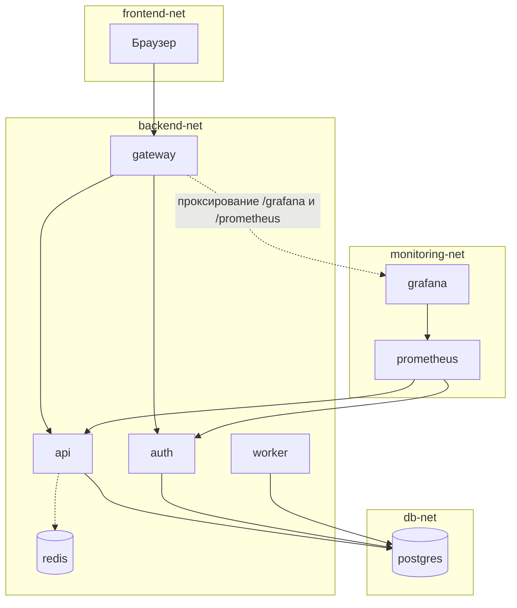
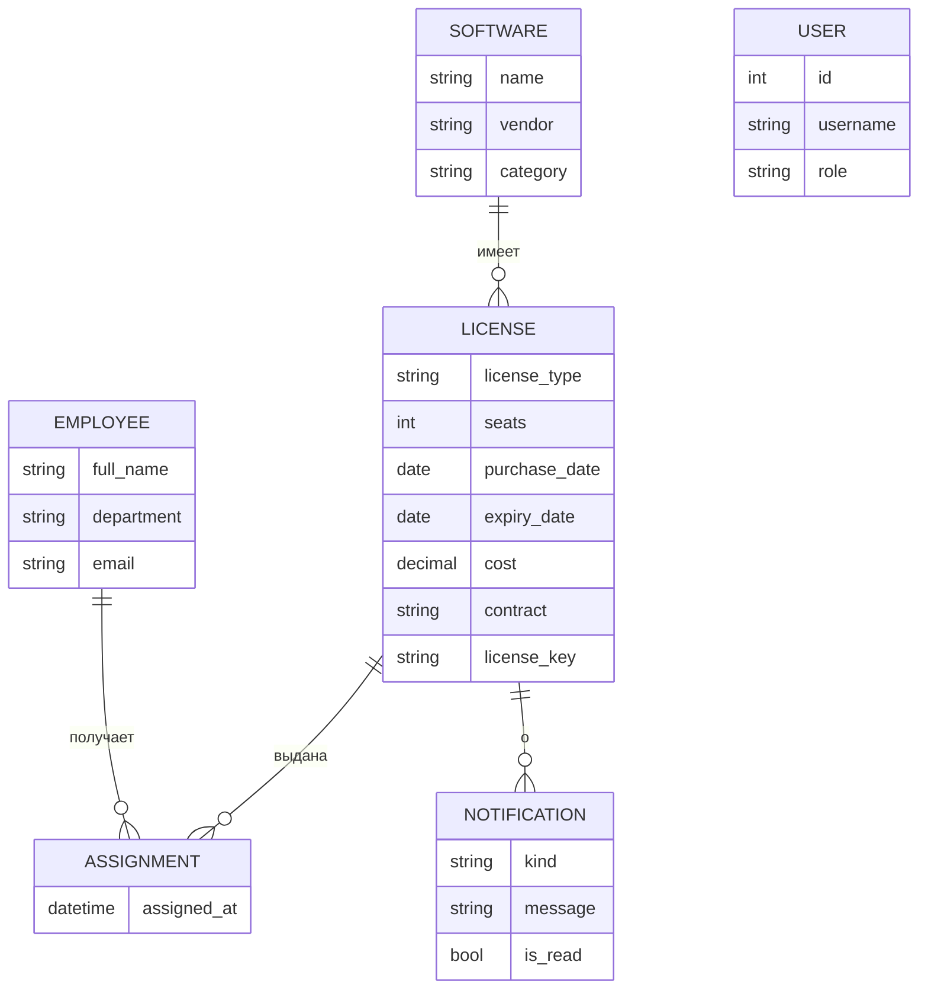

# Архитектура

## Компоненты

Запрос пользователя идёт так: браузер, gateway, api или auth, postgres.
Токен выдаёт auth. Api проверяет подпись токена сам, поэтому ему не нужно обращаться к auth на каждый запрос.

## Назначение контейнеров и обоснование количества

| Контейнер | Зачем отдельный контейнер |
|---|---|
| gateway | одна точка входа и единственный опубликованный порт. Backend-сервисы снаружи недоступны |
| api | основная логика. Масштабируется репликами независимо от остальных |
| auth | авторизация отделена от данных: можно менять и масштабировать отдельно, у неё другая нагрузка |
| worker | фоновые проверки не должны тормозить ответы api. Реплика одна, чтобы уведомления не дублировались |
| postgres | хранение данных. Состояние вынесено из приложения, поэтому api и auth можно перезапускать и реплицировать |
| redis | кэш дашборда. Показывает, что система работает и без него (переменная `REDIS_ENABLED`) |
| prometheus | собирает метрики api и auth |
| grafana | показывает метрики на готовом дашборде |

Получается 8 контейнеров. Требование «не меньше пяти» выполняется, причём без redis, prometheus и grafana система тоже работает (это пять базовых контейнеров плюс наблюдаемость и кэш).
Для защиты: каждый контейнер делает одну задачу, и любой из них можно заменить или масштабировать, не трогая остальные.

## Сети

| Сеть | Кто в ней | Зачем |
|---|---|---|
| frontend-net | gateway | единственная сеть с выходом наружу, через неё работает опубликованный порт |
| backend-net | gateway, api, auth, worker, redis | связь gateway с сервисами |
| db-net | api, auth, worker, postgres | только те, кому нужна БД |
| monitoring-net | prometheus, grafana, api, auth, gateway | опрос метрик. Gateway нужен, чтобы показывать Grafana по адресу `/grafana/` |

Сети backend, db и monitoring помечены как `internal`: из них нет выхода в интернет.
Postgres виден только из db-net и не публикуется наружу ни в одном профиле.
Gateway не состоит в db-net, поэтому не видит postgres.
Проверка: [docs/LOCAL.md](LOCAL.md), раздел «Проверка сетей».

## Модель данных

Правила:
- На одну лицензию нельзя выдать больше мест, чем куплено. Проверка идёт под блокировкой строки лицензии, чтобы два запроса не заняли последнее место одновременно.
- Один сотрудник не получает одну лицензию дважды.
- Просроченную лицензию выдать нельзя.
- Лицензионный ключ хранится в БД, наружу отдаётся только в маске (`****-WXYZ`).
- Просроченные лицензии не входят в подсчёт мест на дашборде.

## Принятые решения

**Миграции.** Вместо Alembic используется `create_all` при старте. Так проще для учебного проекта.
Чтобы несколько реплик не создавали таблицы одновременно, используется advisory lock в PostgreSQL: первая реплика создаёт таблицы, остальные ждут и находят готовую схему. Сервис также ждёт появления БД, поэтому порядок запуска не важен.
Ограничение: изменения уже существующих таблиц так не применяются. Для реального проекта нужен Alembic.

**Секреты.** Приложение читает `NAME_FILE`, если оно задано. В Swarm это путь к docker secret, локально обычные переменные из `.env`, в Kubernetes значения из Secret.

**JWT.** Подпись HS256 с общим секретом у api и auth. Роль берётся из токена, поэтому изменение роли вступает в силу после истечения токена (по умолчанию 60 минут).

**Сеть без https.** Сайт на VPS работает по http, поэтому пароли и токены идут открытым текстом. Для реального использования нужен https.

**Метрики.** Свои метрики `lic_*` считаются в момент запроса `/metrics`. Все реплики api отдают одинаковые значения, поэтому в Grafana используется `max(...)`.
